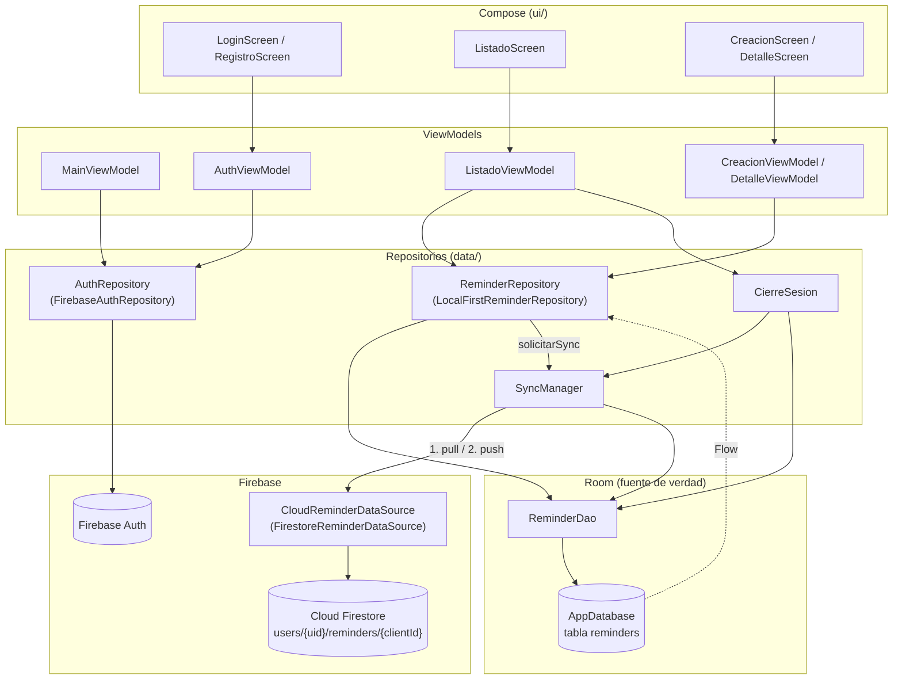

# Evidencias de la Actividad 4

Documentación de pruebas de la app Recordatorios con Firebase Auth y Cloud Firestore.
Este documento no incluye capturas de pantalla. Cada resultado indica de dónde sale:

- **Verificado**: lo probé a mano en el emulador (con el release, o en los pasos 3, 4 y 5-previo).
- **Por código**: es lo que hace el código; no se observó por separado en una prueba manual.

Documentos relacionados: [reglas-seguridad.md](reglas-seguridad.md) y
[registro-release.md](registro-release.md).

---

## 1. Esquema del flujo

`AppContainer` crea todas las dependencias (inyección manual) y en
`vincularSincronizacionASesion()` conecta la sesión con la sincronización:
con usuario llama a `SyncManager.iniciar()`; sin usuario llama a
`CierreSesion.limpiarDatosLocales()`.

### Responsabilidad de cada capa

**Compose (`ui/`).** Dibuja el estado que exponen los ViewModels y les avisa de los
eventos (tocar Guardar, Eliminar, Cerrar sesión, pull-to-refresh). No tiene lógica de
datos. Ningún archivo de `ui/`, `navigation/` ni `MainActivity.kt` importa
`com.google.firebase`: **Compose nunca llama a Firebase**. La navegación reacciona al
`EstadoSesion` de `MainViewModel` (`Verificando` → splash, `SinSesion` → login,
`Autenticado` → listado).

**ViewModels.** Validan los formularios (`ValidacionAuth`, `ValidacionRecordatorio`),
llaman a los repositorios dentro de `viewModelScope` y exponen `StateFlow` para la UI.
Dependen de las interfaces `AuthRepository` y `ReminderRepository`, no de Firebase.
`MainViewModel` revalida la sesión guardada al abrir la app; `ListadoViewModel` combina
recordatorios, preferencias, estado del sync y conectividad, y maneja el cierre de sesión
en dos pasos.

**Repositorios.**
- `FirebaseAuthRepository`: único lugar que conoce `FirebaseAuth`/`FirebaseUser`.
  Expone `currentUser` como `Flow<AuthUser?>` y traduce los errores a `AuthError`
  (mensajes propios de la app, sin texto de Firebase).
- `LocalFirstReminderRepository`: toda escritura va primero a Room, marcada como
  pendiente, y termina al instante; después pide `syncManager.solicitarSync()`. Las
  lecturas usan `flatMapLatest` sobre el uid de la sesión: al cambiar de usuario se
  cancela la consulta anterior.
- `CierreSesion`: sincroniza antes de salir, cuenta lo que quedó sin subir, detiene el
  sync, borra Room (`clearAllTables`) y los datos de sesión de DataStore, y recién
  después hace `logout()`.
- `SyncManager`: sincroniza Room con Firestore (ver orden abajo).

**Room.** `AppDatabase` (versión 2) con la tabla `reminders` (`ReminderEntity`). Es la
única fuente de verdad que observa la UI. Cada fila tiene `user_id` (uid de Firebase
Auth, sin valor por defecto), `client_id` (UUID, índice único) y `sync_status`
(`PENDING_CREATE`, `PENDING_UPDATE`, `PENDING_DELETE`, `SYNCED`, `FAILED`). Todas las
consultas de `ReminderDao` filtran por `user_id`, y las de la UI excluyen
`PENDING_DELETE`.

**Firebase.**
- Auth: registro, login, logout y revalidación de la sesión guardada.
- Firestore: `FirestoreReminderDataSource` lee y escribe en
  `users/{uid}/reminders/{clientId}` con `set()` del documento completo, `delete()` y
  `get(Source.SERVER)`. Cada operación tiene un timeout de 15 s. Los errores se
  traducen a `CloudException` (`SinConexion`, `PermissionDenied`, `NoAutenticado`,
  `Desconocida`). La caché persistente de Firestore está desactivada
  (`crearFirestoreSinCachePersistente`).

### Orden de la sincronización: pull antes que push

Cada vuelta de `SyncManager.sincronizar()` hace, en este orden:

1. **Pull**: `fetchAll(uid)` baja todos los documentos del usuario desde el servidor y
   `mezclar()` los aplica en Room dentro de una transacción:
   - documento que no existe localmente → se inserta como `SYNCED`;
   - fila local `PENDING_DELETE` → no se resucita;
   - `updatedAt` de la nube mayor que el local → se pisa la fila (mismo `id`) y queda
     `SYNCED`;
   - local igual o más nuevo → no se toca (si estaba pendiente, se sube en el push);
   - filas `SYNCED` que ya no están en la nube → se borran (se borraron en otro
     dispositivo). Nunca se borran filas pendientes o `FAILED`.
2. **Push**: `getPendingSync(uid)` (ordenado por `updated_at`) y por cada fila
   `upsert` o `delete`. Si la nube confirma: `markSynced` (o `deleteIfPendingDelete`),
   comparando `updated_at` con el valor enviado para no pisar una edición hecha mientras
   viajaba la petición.

Motivo del orden: si otro dispositivo dejó una versión más nueva, se aplica antes de
subir nada y el push no la pisa. Si el pull falla, **no se hace el push** (subir sin
conocer la nube podría pisar una versión más nueva) y todo queda pendiente.

Otros detalles del `SyncManager`:
- Un solo sync a la vez (`Mutex.tryLock`); si llega un pedido durante un sync, se hace
  una vuelta más al terminar.
- El uid se captura al empezar y, después de cada espera a la nube, se verifica que la
  sesión siga siendo la misma antes de escribir en Room. Si cambió, se aborta.
- Disparadores: `iniciar()` sincroniza cada vez que `ConnectivityObserver` informa que
  hay red (incluye el primer sync de la sesión); `solicitarSync()` después de cada cambio
  local (sin red no hace nada); y el sync manual del listado.
- Si Firestore responde `UNAUTHENTICATED`, se cierra la sesión y eso dispara la limpieza
  local.

---

## 2. Escenarios de sincronización

En todos los casos `uidA` es el uid de la cuenta logueada y `c1` el `clientId` (UUID)
generado al crear el recordatorio. El estado que ve el usuario en cada tarjeta sale de
`EstadoSync`: `PENDING_*` → "Pendiente de sincronizar", `SYNCED` → "Sincronizado",
`FAILED` → "Error al sincronizar".

### (a) Crear con conexión

Verificado: release (prueba 4 del registro) y paso 3 contra Firestore real.

| # | Paso | Room | Firestore | Qué ve el usuario |
|---|---|---|---|---|
| 1 | Completa el formulario y toca Guardar (`CreacionViewModel.onGuardar` → `LocalFirstReminderRepository.crear`). | Se inserta una fila con `user_id = uidA`, `client_id = c1`, `sync_status = PENDING_CREATE`, `created_at = updated_at = ahora`. | Todavía nada. | Vuelve al listado; el recordatorio aparece enseguida (Flow de Room). |
| 2 | `solicitarSync()`: hay red, se lanza `sincronizar()`. Pull. | Sin cambios (el documento no existe en la nube; la fila sigue `PENDING_CREATE`). | `get` de `users/uidA/reminders`. | Franja: "Sincronizando…". |
| 3 | Push: `upsert(uidA, …)`. | Al confirmar, `markSynced`: `sync_status = SYNCED` (misma fila, mismo `id`). | Se crea `users/uidA/reminders/c1` con los nueve campos (`clientId = c1`). | La tarjeta pasa a "Sincronizado"; la franja muestra "Última sincronización: …". |

### (b) Crear en modo avión y reconectar, sin duplicados

Verificado: release (prueba 7 del registro) y paso 3 contra Firestore real.

| # | Paso | Room | Firestore | Qué ve el usuario |
|---|---|---|---|---|
| 1 | Activa el modo avión. | Sin cambios. | Sin cambios. | Franja: "Sin conexión: los cambios se guardan en el dispositivo". |
| 2 | Crea un recordatorio. | Fila nueva `user_id = uidA`, `client_id = c1`, `sync_status = PENDING_CREATE`. `solicitarSync()` no hace nada porque no hay red. | Nada. | El recordatorio aparece con "Pendiente de sincronizar"; la franja agrega "1 cambio pendiente". |
| 3 | Desactiva el modo avión. `ConnectivityObserver` emite `true` y `iniciar()` lanza `sincronizar()`. Pull. | El documento `c1` no está en la nube: la fila sigue `PENDING_CREATE`. | `get` de `users/uidA/reminders`. | "Sincronizando…". |
| 4 | Push: `upsert` de `c1`. | `markSynced` → `SYNCED` en la misma fila. | Se crea `users/uidA/reminders/c1`. | "Sincronizado"; desaparece el contador de pendientes. |

**Por qué no se duplica** (por código):
- El ID del documento es el `clientId`, generado una sola vez al crear. Reenviar hace
  `set()` sobre el mismo documento: lo pisa, no crea otro.
- En Room, `client_id` tiene índice único e `insert` usa `OnConflictStrategy.ABORT`; el
  pull busca por `client_id` antes de insertar y la confirmación (`markSynced`) actualiza
  la fila existente, nunca inserta.
- Si un `set()` quedó encolado en memoria por Firestore mientras no había red y llega
  después, escribe el mismo documento con el mismo contenido.

Si se pierde la red en medio del sync (por código): el sync se corta con `SinConexion`,
las filas siguen pendientes (no se marcan `FAILED`) y se reintenta en la próxima
reconexión. La franja muestra "Sin conexión. Tus cambios quedan guardados y se enviarán
al reconectar."

### (c) Editar o borrar con conexión

Verificado: release (prueba 4 del registro); borrado también en el paso 3 contra
Firestore real.

**Editar**

| # | Paso | Room | Firestore | Qué ve el usuario |
|---|---|---|---|---|
| 1 | Edita el recordatorio `c1` (que estaba `SYNCED`) y guarda (`actualizar`). | `update` de la misma fila (`aplicarEdicion`): mismo `id`, `client_id`, `user_id` y `created_at`; nuevo `updated_at`; `sync_status = PENDING_UPDATE` (si todavía era `PENDING_CREATE`, sigue así). | Sin cambios todavía. | El cambio se ve al instante, con "Pendiente de sincronizar". |
| 2 | Sync: pull. | El `updatedAt` de la nube es menor que el local: no se pisa. | `get` de la colección. | "Sincronizando…". |
| 3 | Push: `upsert` de `c1`. | `markSynced` → `SYNCED` (solo si `updated_at` no cambió durante el envío). | `set()` reemplaza `users/uidA/reminders/c1` completo con el contenido nuevo. | "Sincronizado". |

Marcar o desmarcar "completado" desde el detalle (`cambiarCompletado`) sigue el mismo
camino.

**Borrar**

| # | Paso | Room | Firestore | Qué ve el usuario |
|---|---|---|---|---|
| 1 | Confirma Eliminar en el detalle (`DetalleViewModel.onEliminarConfirmado` → `eliminar`). | Borrado lógico: la fila queda `sync_status = PENDING_DELETE` con `updated_at` nuevo. | Sin cambios todavía. | El detalle pasa a "Eliminado" y el recordatorio desaparece del listado (las consultas de la UI excluyen `PENDING_DELETE`). |
| 2 | Sync: pull. | El documento sigue en la nube, pero la fila es `PENDING_DELETE`: no se resucita. | `get` de la colección. | Nada nuevo. |
| 3 | Push: `delete(uidA, c1)`. | Al confirmar, `deleteIfPendingDelete` borra la fila físicamente. | Se borra `users/uidA/reminders/c1`. | Nada nuevo (ya no estaba visible). |

Si Firestore rechazara una edición (`PermissionDenied` o error desconocido), la fila
quedaría `FAILED` y la tarjeta mostraría "Error al sincronizar" con la opción de
reintentar (por código). Un borrado rechazado no se marca `FAILED`: sigue
`PENDING_DELETE`, oculto, y se reintenta en el próximo sync.

### (d) Logout y login con otra cuenta, sin datos mezclados

Verificado: release (pruebas 8 y 9 del registro), paso 4 con dos cuentas reales y
logout manual en el paso 5-previo. La fila 4 es **Por código** (no se probó que B creara
un recordatorio).

| # | Paso | Room | Firestore | Qué ve el usuario |
|---|---|---|---|---|
| 1 | Con la cuenta A, toca Cerrar sesión y confirma. `CierreSesion.sincronizarAntesDeSalir()` intenta subir lo pendiente. | Las filas de `uidA` pendientes pasan a `SYNCED` si hay red. | Se suben los pendientes a `users/uidA/reminders/…`. | Diálogo "¿Cerrar sesión?" y luego "Sincronizando cambios pendientes…". Si algo quedó sin subir: "Hay cambios sin sincronizar" con "Cerrar sesión igual" o Cancelar. |
| 2 | `cerrarSesion()`: detiene el sync, borra la base y después hace `logout()`. | `clearAllTables()`: la tabla `reminders` queda vacía. En DataStore se borran la hora del último sync, orden, filtro de prioridad y "mostrar completados". | Sin cambios: los documentos de A siguen en `users/uidA/reminders`. | "Cerrando sesión…" y vuelve al login con el historial de navegación limpio. |
| 3 | Inicia sesión con la cuenta B. `seguirLaSesion` detecta la sesión y llama a `SyncManager.iniciar()`: pull de B. | Se insertan solo los documentos de B, con `user_id = uidB` y `SYNCED`. | `get` de `users/uidB/reminders` (nunca de `uidA`). | Ve únicamente los recordatorios de B; ninguno de A. |
| 4 | B crea un recordatorio (**Por código**). | Fila con `user_id = uidB`, `PENDING_CREATE` → `SYNCED`. | Se crea en `users/uidB/reminders/{clientId}`. | Igual que el escenario (a). |

Barreras contra la mezcla de datos (por código):
- Room se vacía antes del logout; si la limpieza falla, no se hace el logout y la sesión
  de A sigue abierta (diálogo "No se pudo cerrar la sesión. Intentá de nuevo.").
- Toda consulta del DAO filtra por `user_id`, y el repositorio reabre las consultas con el
  uid nuevo (`flatMapLatest`).
- Escribir sin sesión lanza `SesionRequeridaException`: nunca se guarda una fila sin dueño.
- El `SyncManager` verifica que la sesión siga siendo la misma después de cada espera a
  la nube; si cambió, aborta sin escribir.
- La ruta de Firestore se arma siempre con el uid de la sesión actual, y las reglas
  rechazan cualquier otro uid (sección 3).

### Escenarios de sesión (paso 5-previo)

Verificado en el paso 5-previo:

| Caso | Qué hace la app (por código) | Resultado verificado |
|---|---|---|
| Usuario deshabilitado en la consola de Firebase (con la sesión cerrada, intento de login) | `AuthViewModel.login` → `FirebaseAuthRepository.login` → `signInWithEmailAndPassword` falla con `FirebaseAuthInvalidUserException` (`ERROR_USER_DISABLED`), que `mapearErrorAuth` traduce a `AuthError.CredencialesIncorrectas`. | **Verificado:** la app no deja entrar y muestra "Correo o contraseña incorrectos." || Modo avión con sesión iniciada | Un error de red o el timeout de la revalidación **no** cierran la sesión. La app abre el listado con los datos de Room y los cambios quedan pendientes. | La app sigue funcionando offline con la sesión. |
| Logout manual | Escenario (d), pasos 1 y 2. | Vuelve al login sin datos de la cuenta anterior. |

El caso de una cuenta **borrada** desde la consola de Firebase no se probó. Por código,
seguiría el mismo camino que una cuenta deshabilitada (`FirebaseAuthInvalidUserException`
en `revalidarSesion()` o en el login).

Otras pruebas del release relacionadas con Auth: contraseña incorrecta muestra el mensaje
propio de la app ("Correo o contraseña incorrectos.", de `AuthError`) sin texto de
Firebase; el registro de una cuenta nueva inicia sesión directamente.

---

## 3. Acceso entre cuentas

### Prueba con dos cuentas reales (paso 4)

**Qué intenté** (resultado: **Verificado**), en el emulador:

1. Creé dos cuentas desde la app (cuenta A y cuenta B).
2. Con la cuenta A creé recordatorios y cerré sesión.
3. Entré con la cuenta B: los recordatorios de la cuenta A no aparecieron; no se
   cruzaron datos entre cuentas.
4. Volví a entrar con la cuenta A y sus recordatorios seguían ahí.

**Cómo respondió la app.** La cuenta B no vio los recordatorios de la cuenta A, y la
cuenta A recuperó los suyos al volver a entrar (verificado, pasos 3 y 4). Explicación
por código: al iniciar sesión, el pull baja únicamente
`users/{uid de la sesión}/reminders`, y la app no tiene ninguna operación que reciba un
uid distinto al de la sesión, así que desde la interfaz no hay forma de pedir datos de
otra cuenta.

**Cómo respondió Firestore** (resultado: **Por código**). No se observó un
`PERMISSION_DENIED` real, porque la app solo consulta la ruta `users/{uid}` del usuario
logueado. Según [`firestore.rules`](../firestore.rules), un acceso a la ruta de otro
usuario sería rechazado: la regla `esDueno(uid)` exige `request.auth.uid == uid` (ver
[reglas-seguridad.md](reglas-seguridad.md)).

### Resumen de las reglas

Las reglas se probaron con dos cuentas reales desde la app. Resumen (completo en
[reglas-seguridad.md](reglas-seguridad.md), archivo [`firestore.rules`](../firestore.rules)):

- La única ruta accesible es `users/{uid}/reminders/{reminderId}`; cualquier otra ruta
  queda denegada por defecto.
- `get` y `list`: solo si hay sesión y `request.auth.uid == uid`.
- `create` y `update`: dueño y documento válido (`esRecordatorioValido`): solo los nueve
  campos conocidos; obligatorios presentes; `title` string de 1 a 200 caracteres;
  `description` null o string de hasta 2000; `category` y `priority` dentro de sus
  códigos; `completed` booleano; fechas enteras positivas; `clientId` igual al ID del
  documento.
- `delete`: solo el dueño.
- El límite de 200 caracteres del título coincide con
  `ValidacionRecordatorio.TITULO_MAX_CARACTERES`.

---

## 4. Registro del release

Detalle completo en [registro-release.md](registro-release.md). Resumen (valores copiados
de ese registro, sin recalcular):

| Campo | Valor |
|---|---|
| applicationId | `com.fabrizio.recordatorios` |
| Versión | `versionName 1.0`, `versionCode 1` |
| Variante | `release` (sin product flavors), firmada, R8 activo (shrink, optimización, ofuscación y reducción de recursos) |
| Fecha de compilación | 2026-11-09 16:16 (UTC-3) |
| APK | `app/build/outputs/apk/release/app-release.apk` — SHA-256 `1f44c5d5558b7c686830e12e41a6785fb53038f29ad4d9894d86da55cd11a451` |
| AAB | `app/build/outputs/bundle/release/app-release.aab` — SHA-256 `4be17be09e5d403681d301a0e8e1c2ae81b9495103a19973a260ca71eb768b4e` |
| Firma | APK: `apksigner` → Verifies (esquema v2). AAB: `jarsigner` → jar verified. |

Pruebas finales en el emulador con `app-release.apk` (2026-11-09), todas OK:

1. Instalación del release (`adb install`: Success).
2. SHA-256 de las copias coinciden con el registro.
3. Login: los recordatorios reaparecen desde Firestore.
4. Crear, editar y borrar con sincronización.
5. Preferencias persisten al cerrar y reabrir.
6. Contraseña incorrecta con mensaje propio.
7. Modo avión: creado offline se sincroniza sin duplicarse.
8. Logout y login con otra cuenta sin datos de la anterior.
9. Registro de cuenta nueva.
10. Menú de debug ausente en el release.

---

## 5. Limitaciones conocidas

- **Conflictos resueltos con el reloj del dispositivo.** Gana el `updatedAt` mayor, y ese
  valor sale de `System.currentTimeMillis()` del dispositivo que hizo el cambio. Un
  reloj adelantado o atrasado hace que sus cambios ganen o pierdan de más. Ante empate
  gana lo local.
- **Caché offline de Firestore desactivada.** Se usa solo caché en memoria
  (`MemoryCacheSettings`): Room es la única copia offline. Una escritura que Firestore
  encola sin red vive solo mientras viva el proceso; lo que garantiza que no se pierda es
  que la fila sigue pendiente en Room. Las lecturas son siempre `Source.SERVER`, así que
  sin red el pull falla (con timeout de 15 s) y el sync se reintenta al reconectar.
- **Sin transacciones entre pull y push.** Si otro dispositivo escribe entre el pull y el
  push, ese cambio no se vio y el push lo pisa con la versión local.
- **Edición local contra borrado remoto.** Si el documento se borró en otro dispositivo
  pero acá hay una edición pendiente, gana la edición y el push vuelve a crear el
  documento.
- **Sin sincronización en tiempo real.** No hay snapshot listeners: los cambios de otro
  dispositivo llegan en el próximo sync (reconexión, cambio local o sync manual).
- **Sin sincronización en segundo plano.** El sync corre en el scope del proceso (no hay
  WorkManager); si el proceso muere con cambios pendientes, se suben en la próxima
  apertura con red.
- **El logout descarta lo que no se pudo subir.** Si al cerrar sesión quedan cambios sin
  sincronizar (por ejemplo, sin red), la app avisa cuántos son y, si el usuario confirma
  "Cerrar sesión igual", se pierden al borrar Room.
- **El logout reinicia algunas preferencias.** `borrarDatosDeSesion()` borra la hora del
  último sync, el orden, el filtro de prioridad y "mostrar completados"; el tema se
  conserva.
- **Documentos inválidos en la nube.** Si un documento no se puede leer (campo faltante o
  tipo incorrecto), se descarta en el pull y se deja la fila local como está; no se
  muestra ningún aviso al usuario (solo `Log.w`).
- **Revalidación de la sesión al abrir la app.** Solo se consulta al servidor al abrir;
  sin red (o pasados 5 s) se sigue con la sesión guardada. Con la app abierta no
  hay revalidación periódica: una cuenta deshabilitada en ese momento solo se detecta si
  Firestore responde `UNAUTHENTICATED` a un sync, o en la próxima apertura con red.
- **Un único entorno de Firebase.** El release no tiene product flavors: debug y release
  usan el mismo proyecto de Firebase.
