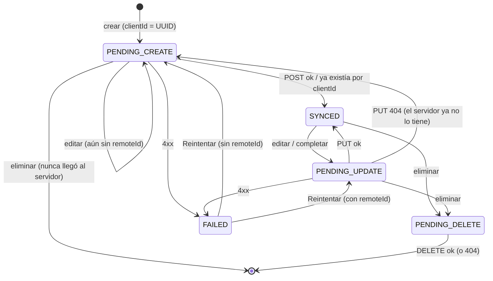
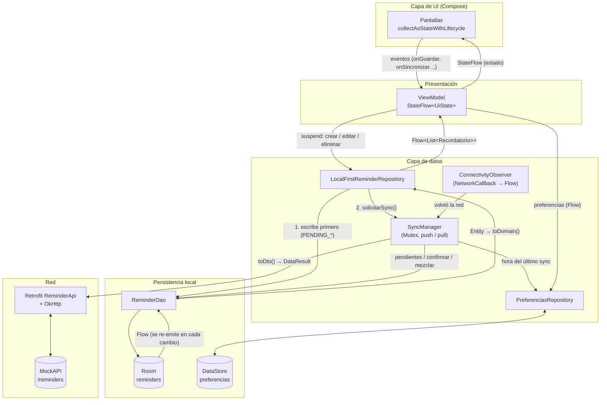
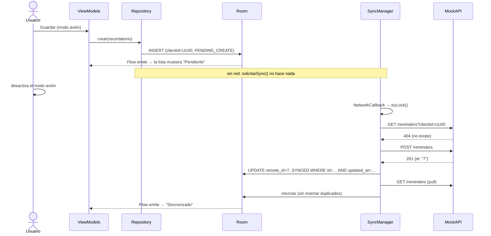

# Informe técnico: Actividad 3 (borrador)

> Borrador de las secciones técnicas. Completar con capturas del
> [checklist de pruebas](checklist-pruebas.md) y adaptar la redacción.

---

## 1. Evolución de la app (Actividad 2 → Actividad 3)

| Aspecto | Actividad 2 | Actividad 3 |
|---|---|---|
| Almacenamiento | Lista en memoria (`MutableStateFlow`); se perdía al cerrar la app | **Room** (SQLite); persiste entre reinicios |
| Preferencias | No había; tema fijo según el sistema | **DataStore**: tema, mostrar completados, orden y filtro de prioridad |
| Repositorio | `RecordatorioRepository` con `suspend obtenerTodos()` y un `Flow<Unit>` de "cambios" para recargar | `ReminderRepository` **local-first**: expone `Flow<List<Recordatorio>>` y coordina Room, DataStore y el servidor |
| Lectura en los ViewModel | Carga puntual + recarga manual | Observación continua: la UI se actualiza sola cuando cambia Room |
| Operaciones | Solo crear | Crear, editar (mismo formulario), completar y eliminar |
| Red | Simulada con demoras y escenarios | Servicio REST real (MockAPI) con Retrofit + OkHttp |
| Offline | No aplicaba | Todas las operaciones funcionan sin red; se sincronizan al reconectar |
| Errores | Error genérico simulado | `DataResult` tipado: 4xx, 5xx, timeout, sin conexión y desconocido |
| Inyección de dependencias | Instancias en la `Application` | `AppContainer` (inyección manual en un solo lugar) |

**Qué se mantuvo:** la arquitectura de presentación de A2 (Screen + UiState
sellado + ViewModel + `StateFlow`, pantallas "con estado" y "sin estado",
`collectAsStateWithLifecycle`, navegación por lambdas). Los ViewModels existentes
evolucionaron, no se reescribieron. Por ejemplo, `CreacionViewModel` ahora también
edita, según si la ruta trae un `id`.

---

## 2. DataStore vs Room

| | **DataStore (Preferences)** | **Room** |
|---|---|---|
| Qué guarda | Configuración liviana de clave-valor | Datos estructurados de la app (entidades) |
| En esta app | Tema, mostrar completados, orden, filtro de prioridad y hora del último sync | Recordatorios con sus campos de sincronización |
| Estructura | Sin esquema; claves tipadas (`stringPreferencesKey`, `booleanPreferencesKey`, `longPreferencesKey`) | Tabla con esquema, índices y versión |
| Consultas | Lee todo el archivo; no hay filtros | SQL: filtros, orden e índice único |
| Lectura | `Flow<Preferences>` | `Flow<List<Entity>>` desde el DAO |
| Escritura | `edit {}` suspend, transaccional | `@Insert` / `@Update` / `@Delete` suspend |
| Errores | `IOException` → `emptyPreferences()` → valores por defecto | Excepciones de SQLite; las migraciones controlan los cambios de esquema |

**Criterio:** DataStore es para *cómo* se ve y se comporta la app. Room es para los
*datos* del usuario. En DataStore **no** se guardan recordatorios, colecciones,
contraseñas ni tokens.

### Detalles de DataStore

- **Una única instancia:** un delegate `preferencesDataStore` a nivel de archivo, en
  `AppContainer.kt`. Dos instancias sobre el mismo archivo hacen que DataStore lance
  una excepción.
- **Modelo propio:** la data class `PreferenciasUsuario`. El resto de la app nunca ve
  `Preferences`, porque un mapeo explícito lo traduce.
- **Valores por defecto en tres casos:**
  1. *No hay datos:* la clave no existe, así que se usa el default del data class.
  2. *Opción desconocida:* por ejemplo, el tema guardado como `"VIOLETA"`.
     `enumODefecto()` busca entre `enumEntries` y, si no encuentra el valor, devuelve
     el default. A diferencia de `enumValueOf`, no lanza excepción.
  3. *`IOException`:* `catch { if (e is IOException) emit(emptyPreferences()) else throw e }`.
- **Escrituras:** funciones `suspend` llamadas desde `viewModelScope.launch`. No
  bloquean el hilo principal y, al terminar, el `Flow` emite el valor nuevo.
- **Tema aplicado:** `MainViewModel` expone `StateFlow<TemaApp?>`, y `MainActivity`
  lo observa y se lo pasa a `RecordatoriosTheme(darkTheme = …)`. Mientras vale
  `null` (DataStore todavía no leyó) no se dibuja nada, para evitar que aparezca un
  tema y enseguida el otro.

### Detalles de Room

- **`ReminderEntity`:**
  - **id local** `Long` autogenerado: es estable y lo usa la navegación;
  - datos del recordatorio;
  - campos de sincronización: `clientId` (UUID, **índice único**), `remoteId`
    (nullable), `syncStatus`, `createdAt` y `updatedAt`.
- **`TypeConverters`:** guardan Categoría, Prioridad y `SyncStatus` como **códigos
  estables** (`"ESTUDIO"`, `"ALTA"`…), no como la etiqueta visible. Un código
  desconocido se convierte en un valor seguro en vez de crashear. Las fechas se
  guardan como epoch millis (`Long`): se ordenan en SQL y evitan `java.time`, que
  requiere API 26 (el minSdk es 24).
- **Base de datos singleton:** `AppDatabase.getInstance()` con `@Volatile` y
  `synchronized`.
- **Versionado:** `version = 1` y `exportSchema = true` (JSON en `app/schemas/`,
  versionado en git). Cada cambio de esquema sube la versión y agrega una `Migration`
  explícita. `fallbackToDestructiveMigration` está activo **solo** si
  `BuildConfig.DEBUG`: en desarrollo se puede recrear la base, pero en release nunca
  se borran datos del usuario en silencio.
- **KSP** procesa las anotaciones de Room en compilación; reemplaza a kapt.
- **Regla:** los composables **nunca** acceden al DAO. El camino es siempre
  Compose → ViewModel → Repository → DAO.

---

## 3. Arquitectura de la capa de datos

```
data/
├── ReminderRepository              ← contrato que ven los ViewModel
├── LocalFirstReminderRepository    ← coordina Room + DataStore + SyncManager
├── local/       Room (ReminderEntity, ReminderDao, AppDatabase, Converters, SyncStatus)
├── remote/      Retrofit/OkHttp (ReminderDto, ReminderApi, ReminderRemoteDataSource,
│                DataResult, NetworkModule, SimuladorFallas)
├── sync/        SyncManager (push/pull + Mutex), ConnectivityObserver, SyncResult
├── mapper/      EntityMappers, DtoMappers
└── preferencias/ PreferenciasRepository (DataStore)
```

### Modelos separados por capa

| Capa | Modelo | Lo conoce |
|---|---|---|
| Red | `ReminderDto` (`@Serializable`) | Retrofit y los mappers de DTO |
| Persistencia | `ReminderEntity` (`@Entity`) | Room, el repositorio y el SyncManager |
| Dominio / UI | `Recordatorio` (+ `EstadoSync`) | ViewModels y pantallas |

**Mappers explícitos** (en `data/mapper/`):
- `ReminderEntity.toDomain()`: resume los 5 `SyncStatus` en 3 `EstadoSync` para el usuario.
- `Recordatorio.toEntity(clientId, ahora)`: alta local con `PENDING_CREATE`.
- `ReminderEntity.aplicarEdicion(...)`: edición que **conserva la identidad**
  (`id`, `clientId`, `remoteId`).
- `ReminderEntity.toDto()`: lo que se envía al servidor.
- `ReminderDto.toEntity(ahora)`: devuelve `null` si el DTO es inválido, y se descarta.
- `ReminderEntity.actualizarDesde(dto)`: aplica datos del servidor a una fila ya sincronizada.

La UI nunca depende de un DTO ni de la conectividad: solo observa `Recordatorio`
desde Room.

### Retrofit + OkHttp

- **URL base:** `local.properties` (`API_BASE_URL`) → `buildConfigField` →
  `BuildConfig.API_BASE_URL`. No está hardcodeada y el archivo real está en `.gitignore`.
- **`ReminderApi`:** funciones `suspend` para `GET` (todos y por `clientId`), `POST`,
  `PUT` y `DELETE`.
- **OkHttp:**
  - timeouts explícitos: conexión 10 s, lectura 15 s, escritura 15 s y llamada total 30 s;
  - `HttpLoggingInterceptor` **solo en debug**.
- **Serialización:** kotlinx.serialization, porque es la librería oficial de Kotlin,
  genera los serializadores en compilación (sin reflexión) y no necesita reglas extra
  de R8. Usa `ignoreUnknownKeys = true` para tolerar campos nuevos del servidor y
  `encodeDefaults = true` (ver "Problemas encontrados", al final de la sección 7).

### Manejo de errores (`DataResult`)

Las excepciones se traducen en la capa de datos, en `llamarApi()`. Ni los ViewModels
ni las pantallas ven `HttpException` o `IOException`.

| Caso | Origen | `DataResult` | ¿Recuperable? | Efecto en el sync |
|---|---|---|---|---|
| Éxito | 2xx | `Exito(datos)` | – | Se confirma en Room |
| Solicitud inválida | HTTP 4xx | `ErrorCliente(código)` | No | Ese registro queda `FAILED`; el resto sigue |
| Error del servidor | HTTP 5xx | `ErrorServidor(código)` | Sí | Se corta el sync; todo queda pendiente |
| Timeout | `SocketTimeoutException` | `Timeout` | Sí | Ídem |
| Sin conexión | `UnknownHostException` / `IOException` | `SinConexion` | Sí | Ídem |
| Desconocido | Otra excepción (por ejemplo, JSON inválido) | `Desconocido(causa)` | Sí | Ídem |

El orden de los `catch` importa: `SocketTimeoutException` es una `IOException`, por
eso se captura antes. `CancellationException` se relanza, porque cancelar una
corrutina no es un error de red.

**En la UI:** el `SyncManager` publica `EstadoSincronizacion.Error(mensaje)`. El
listado muestra un **Snackbar con "Reintentar"** y cada recordatorio muestra su
estado. Los datos locales nunca se borran por un error de red.

---

## 4. Enfoque local-first

**Principio:** Room es la **única fuente de verdad** de la UI. El servidor es una
réplica que se actualiza cuando se puede.

1. El usuario crea, edita, completa o elimina un recordatorio.
2. El repositorio escribe **en Room** y marca el cambio como pendiente. La operación
   termina al instante, haya o no red.
3. El `Flow` del DAO emite y la UI se actualiza sola.
4. Si hay conexión, se pide un sync en segundo plano (`solicitarSync()`). Si no hay,
   el cambio espera.
5. El `SyncManager` envía los pendientes y confirma en Room **sobre la misma fila**,
   sin insertar una nueva.
6. Si el servidor devuelve datos válidos (pull), se mapean a Entity, se escriben en
   Room y la UI se refresca por el `Flow`.

**Disparadores del sync:**
- al abrir la app;
- al **recuperar la red**: `ConnectivityManager.NetworkCallback` expuesto como
  `callbackFlow` con `distinctUntilChanged()`;
- después de cada cambio local, si hay red;
- **manual**: *pull-to-refresh* o el botón ⟳;
- **reintento** desde el Snackbar o desde el detalle.

El `SyncManager` corre en un `CoroutineScope` de la aplicación (`SupervisorJob`), así
que un sync no se corta porque el usuario cambie de pantalla.

---

## 5. Tratamiento de operaciones pendientes

### Estados (`SyncStatus`)

| Estado | Significado | Visible en la UI como |
|---|---|---|
| `PENDING_CREATE` | Existe solo en el dispositivo | Pendiente de sincronizar |
| `PENDING_UPDATE` | Existe en el servidor y tiene cambios locales sin enviar | Pendiente de sincronizar |
| `PENDING_DELETE` | El usuario lo borró; falta confirmarlo en el servidor | Oculto (las consultas lo excluyen) |
| `SYNCED` | Coincide con el servidor | Sincronizado |
| `FAILED` | El servidor lo rechazó (4xx) | Error al sincronizar + botón Reintentar |

### Transiciones



### Reglas clave

- **Editar algo que nunca se sincronizó** lo deja en `PENDING_CREATE`: se enviará
  **un solo POST** con los datos más nuevos, no un POST y después un PUT.
- **Eliminar algo sin `remoteId`** lo borra físicamente al instante, porque el
  servidor nunca lo conoció. Con `remoteId` es un **borrado lógico** (`PENDING_DELETE`).
- **Orden de envío:** por `updatedAt` ascendente, en el orden en que se hicieron.
- **Errores recuperables** (red, timeout, 5xx): se corta el sync y nada cambia en
  Room. Se reintenta en el próximo disparador.
- **Errores 4xx:** reenviar lo mismo no sirve, así que el registro queda `FAILED` y
  **no se reenvía automáticamente**. Solo vuelve a pendiente con "Reintentar".
- **Confirmaciones condicionales:** `markSynced`, `markFailed` y
  `deleteIfPendingDelete` incluyen `WHERE updated_at = :enviado` (o `sync_status`).
  Si el usuario editó el registro mientras la petición viajaba, la confirmación no
  pisa su cambio, y el registro sigue pendiente para la próxima vuelta.
- **Pull:** las filas con cambios pendientes **no se sobrescriben** (gana lo local);
  las `SYNCED` toman los datos del servidor; las `SYNCED` que ya no están en el
  servidor se eliminan. Todo el pull corre en una transacción de Room.

---

## 6. Estrategia anti-duplicados

El riesgo: el mismo recordatorio termina dos veces en el servidor o en Room. Las
medidas son estas:

| # | Medida | Dónde | Qué evita |
|---|---|---|---|
| 1 | **`clientId` (UUID)** generado una sola vez al crear e índice **único** en Room | `toEntity()`, `ReminderEntity` | Dos filas locales para el mismo recordatorio |
| 2 | **Verificación previa al POST:** `GET reminders?clientId=…`. Si existe, se adopta su `id` y se hace PUT | `SyncManager.enviarCreacion()` | Duplicado en el servidor cuando un POST anterior llegó pero se perdió la respuesta (timeout o corte) |
| 3 | **Guardar el `remoteId` al confirmar**, en la **misma fila** (`UPDATE … WHERE id = …`, nunca `INSERT`) | `confirmarCreacion()` | Volver a crear algo ya confirmado |
| 4 | **Un único sync a la vez:** `Mutex.tryLock()`. Si hay uno en curso, el pedido nuevo devuelve `EnCurso` y solo marca "otra vuelta" | `SyncManager.sincronizar()` | Que varios eventos de reconexión lancen syncs en paralelo y envíen lo mismo dos veces |
| 5 | **Las operaciones confirmadas no se reenvían:** solo se envía lo que está en `PENDING_*`; `SYNCED` y `FAILED` quedan fuera | `getPendingSync()` | Reintentos de algo ya confirmado |
| 6 | **Pull por `remoteId` y después por `clientId`** antes de insertar | `SyncManager.mezclar()` | Insertar localmente un registro que ya existe |
| 7 | **DELETE idempotente:** un 404 cuenta como éxito | `RetrofitReminderRemoteDataSource.eliminar()` | Que un borrado reintentado quede como error |
| 8 | **Borrado durante un POST en curso:** si la fila desapareció al confirmar, se borra también en el servidor | `confirmarCreacion()` | Registros huérfanos en el servidor |

**Limitación del servicio:** MockAPI no soporta el header `Idempotency-Key`, por eso
la idempotencia se resuelve del lado del cliente (medida 2). Además, el filtro de
MockAPI busca coincidencias parciales, así que el cliente exige igualdad exacta del
`clientId`. Cuando no hay resultados responde 404, que se interpreta como "no existe".

**Cómo se demostró:** con el simulador "Timeout después de enviar", el POST llega al
servidor pero la app recibe un timeout. Al reintentar, Logcat muestra
`GET ?clientId=… → 200`, después `PUT /reminders/{id}` y **ningún POST**. El servidor
queda con una sola copia. Lo cubren también los tests de `SyncManagerTest`.

---

## 7. Flujo de datos

### 7.1 Diagrama (Mermaid)



### 7.2 Esquema ASCII (versión para el documento)

```
 ┌──────────────┐  eventos   ┌──────────────┐  suspend    ┌───────────────────────────┐
 │   Compose    │ ─────────► │  ViewModel   │ ──────────► │ LocalFirstReminderRepo    │
 │  (pantallas) │ ◄───────── │ StateFlow<Ui>│ ◄────────── │  (coordina todo)          │
 └──────────────┘  estado    └──────┬───────┘    Flow     └──┬──────────┬─────────────┘
                                    │ Flow prefs              │ 1.escribe │ 2.solicitarSync()
                                    ▼                         ▼           ▼
                           ┌────────────────┐       ┌──────────────┐  ┌───────────────────┐
                           │   DataStore    │◄──────│  Room (DAO)  │◄─│   SyncManager     │◄── ConnectivityObserver
                           │ (preferencias, │ hora  │  reminders   │  │ Mutex · push/pull │    (vuelve la red)
                           │  último sync)  │ sync  │ FUENTE DE    │  └─────────┬─────────┘
                           └────────────────┘       │ VERDAD de UI │            │ toDto() / DataResult
                                                    └──────────────┘            ▼
                                                                      ┌───────────────────┐
                                                                      │ Retrofit + OkHttp │
                                                                      └─────────┬─────────┘
                                                                                ▼
                                                                      ┌───────────────────┐
                                                                      │  MockAPI (REST)   │
                                                                      └───────────────────┘
```

### 7.3 Secuencia: crear sin conexión y sincronizar al reconectar



**Problemas encontrados en las pruebas contra el servidor real (y su corrección):**
1. kotlinx.serialization **omite por defecto los campos que valen lo mismo que el
   default del DTO** (`completed = false`, `description = null`). Como el PUT de
   MockAPI es parcial, desmarcar un completado no llegaba al servidor, y los campos
   omitidos se rellenaban con valores aleatorios. Se corrigió con
   `encodeDefaults = true` y un test (`ReminderDtoJsonTest`).
2. El simulador "timeout después de enviar" afectaba también al GET de verificación,
   así que el sync se cortaba antes del POST. Se limitó a las escrituras.

---

## 8. Decisiones técnicas (resumen)

| Decisión | Motivo |
|---|---|
| Inyección manual (`AppContainer`) en vez de Hilt | Fácil de explicar; un solo lugar donde se crean las dependencias |
| kotlinx.serialization en vez de Moshi | Oficial de Kotlin, generación en compilación, sin reflexión ni reglas extra de R8 |
| Id local `Long` + `clientId` UUID + `remoteId` | La navegación no cambia al sincronizar; la idempotencia no depende del servidor |
| Fechas como epoch millis | Se ordenan en SQL; evitan `java.time` (API 26) con minSdk 24 |
| Borrado lógico (`PENDING_DELETE`) | El borrado se ve al instante y se puede confirmar después en el servidor |
| `Mutex.tryLock()` (single-flight) | Varios disparadores juntos no generan syncs en paralelo |
| Simulador de fallas como interceptor de OkHttp (solo debug) | MockAPI no permite forzar 4xx, 5xx ni timeouts; el código de producción no cambia |

## 9. Pruebas automatizadas

`./gradlew testDebugUnitTest`: **26 tests**, sin emulador.

- `SyncManagerTest` (8):
  - envío único con `remoteId`;
  - adopción por `clientId`;
  - timeout después de enviar sin duplicar;
  - 5xx conserva los pendientes;
  - 4xx pasa a `FAILED` y se reintenta;
  - un solo sync a la vez (Mutex);
  - borrado pendiente;
  - pull que respeta los cambios locales.
- `LocalFirstReminderRepositoryTest` (5): reglas de pendientes al crear, editar y
  eliminar.
- `ReminderDtoJsonTest` (2): se envían los campos con valor por defecto y se ignoran
  los campos desconocidos.
- `ConvertersTest` (3), `OrdenYFiltroTest` (4), `ValidacionRecordatorioTest` (3) y
  `ExampleUnitTest` (1).
